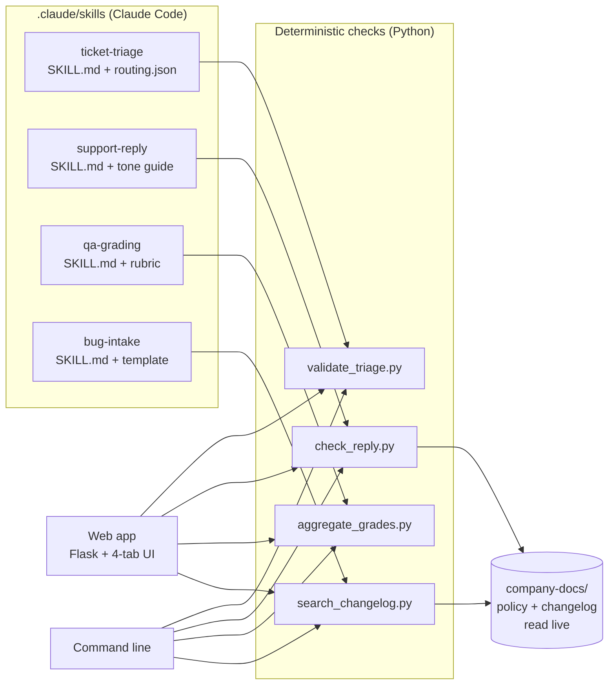

# Support Skills Console

[](https://github.com/sujalghanti14/support-skills-console/actions/workflows/tests.yml)

**Live demo:** https://support-skills-console.onrender.com *(free hosting: the first visit after a quiet spell takes up to ~50 s to wake)*

**Submission documents:** [Project report (.docx)](submission/Project-Report.docx) · [Presentation (.pptx)](submission/Presentation.pptx)

---

## The brief

A mid-size SaaS company handles support manually through one shared inbox. Leadership wants an AI assistant to take over five workflows:

1. Triage and route new tickets in minutes, and escalate outages and legal/security issues immediately.
2. Keep every reply on-brand, and never quote a refund or price that isn't in the current (often-changing) policy.
3. Build a one-page briefing for "at-risk" customers from three systems (billing, usage logs, past tickets).
4. Grade a weekly sample of closed tickets against a rubric and summarise the recurring failures.
5. Check reported bugs against the changelog, and write up new ones for engineering.

**Task:** decide which pieces need a **Skill**, an **Agent**, or **Neither**, justify each, and build the skills. Agents could be skipped, and no orchestration was needed.

## Decisions

| Workflow piece | Decision | One-line reason |
|---|---|---|
| Keyword escalation (outage / legal / security) | **Neither**: a ticketing-tool rule | Must be instant and can't miss; a regex is deterministic and auditable |
| Categorise + route | **Skill**: `ticket-triage` | One-pass judgment that needs company know-how (taxonomy, team ownership) |
| On-brand, policy-safe replies | **Skill**: `support-reply` | Voice rules are stable know-how; figures are checked by a script against the *live* policy |
| At-risk account briefing | **Agent** *(designed, not built)* | Three systems, dependent queries, lots of raw data to keep out of the main context |
| Weekly sampling + schedule | **Neither**: cron + query | Deterministic and reproducible |
| Rubric grading + pattern summary | **Skill**: `qa-grading` | The rubric is the knowledge; a script does the arithmetic |
| Known-issue check + bug write-up | **Skill**: `bug-intake` | Bounded search of one document plus a house template |

The full reasoning is in **[DECISIONS.md](DECISIONS.md)**.

**Rule of thumb:** no judgment needed → *Neither*. Judgment with company know-how, on input that fits in context → *Skill*. Exploring several systems and digesting lots of raw data → *Agent*.

## How it fits together



Each skill pairs **instructions for the model** (`SKILL.md`: the procedure, rules and output format) with a **script for the parts that must be exact** (figures, scores, schema checks). The CLI and the web app call the same functions, so they always agree.

## The four skills

| Skill | What the model does | What the script guarantees |
|---|---|---|
| [`ticket-triage`](.claude/skills/ticket-triage/SKILL.md) | Picks category, team, priority; flags escalations a regex would miss | Valid category/team pairing, escalations routed to the right team and marked urgent |
| [`support-reply`](.claude/skills/support-reply/SKILL.md) | Drafts the reply in the company voice | Every $, %, and time window exists in the current policy; no money in words; no banned phrases |
| [`qa-grading`](.claude/skills/qa-grading/SKILL.md) | Scores each ticket on 5 criteria with quoted evidence | Rubric-valid grades, pass rule, pass rates, recurring patterns |
| [`bug-intake`](.claude/skills/bug-intake/SKILL.md) | Decides KNOWN_OPEN / FIXED / NEW and writes the engineering report | Ranked changelog candidates with match scores |

## Web app


A small Flask app with one tab per skill. Each tab has a **Load example** button and a plain-language **How to use this** guide. It supports dark mode and phone screens, and is hosted on Render (`render.yaml`).

## Testing

**73 automated tests**, run on every push by GitHub Actions:

| Suite | Count | Covers |
|---|---|---|
| Unit | 35 | Each script's logic: ranges, bool-as-int, word boundaries, live policy changes, pass rule, pattern threshold |
| API | 23 | Every endpoint, bad input (400/404/405/413), security headers, policy re-read on each request |
| Browser (Playwright) | 15 | Every tab end to end, keyboard navigation, HTML injection, server failure, download, phone width, zero console errors |

Testing caught and fixed real bugs, for example: `"fifty dollar"` slipping past the words check, a range like `3-5 days` half-passing, `true` accepted as a score, and the QA script calling `sys.exit` (which would kill a web server).

## Run it yourself

```bash
pip install -r requirements.txt
python webapp/app.py
```

Then open http://127.0.0.1:5000.

To run the tests:

```bash
pip install -r requirements-dev.txt
python -m playwright install chromium
python webapp/run_tests.py
```

Each skill script also runs on its own, for example:

```bash
python .claude/skills/support-reply/scripts/check_reply.py samples/reply-bad.txt --policy company-docs/refund-pricing-policy.md
```

## Repository layout

| Path | Contents |
|---|---|
| `.claude/skills/` | The four skills: instructions, references, scripts |
| `company-docs/` | Refund/pricing policy and changelog the checks read on every run |
| `samples/` | Example inputs for each skill (good and bad) |
| `webapp/` | Flask app, static UI, tests, screenshots |
| `submission/` | Project report and presentation |
| `DECISIONS.md` | Skill vs Agent vs Neither reasoning |
| `render.yaml`, `requirements*.txt` | Hosting and dependencies |
| `.github/workflows/tests.yml` | CI: runs every test on each push |

## Known limitations

- The reply checker confirms a figure *exists* in the policy, not that it's used for the *right clause* ("25% annual discount" passes because 25% is an outage credit). The skill makes the model cite the clause it relied on to cover this.
- The at-risk briefing agent is designed but not built, as the brief allowed.
- The hosted demo has no login. It is read-only and stores nothing people type.
